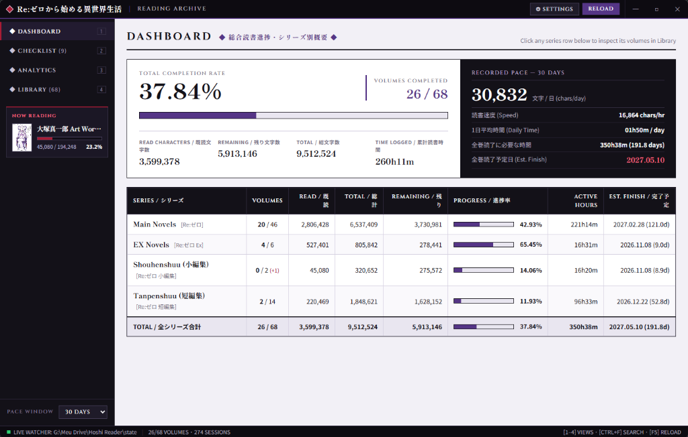
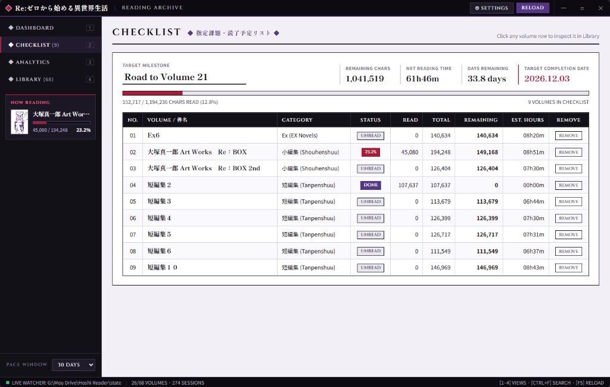
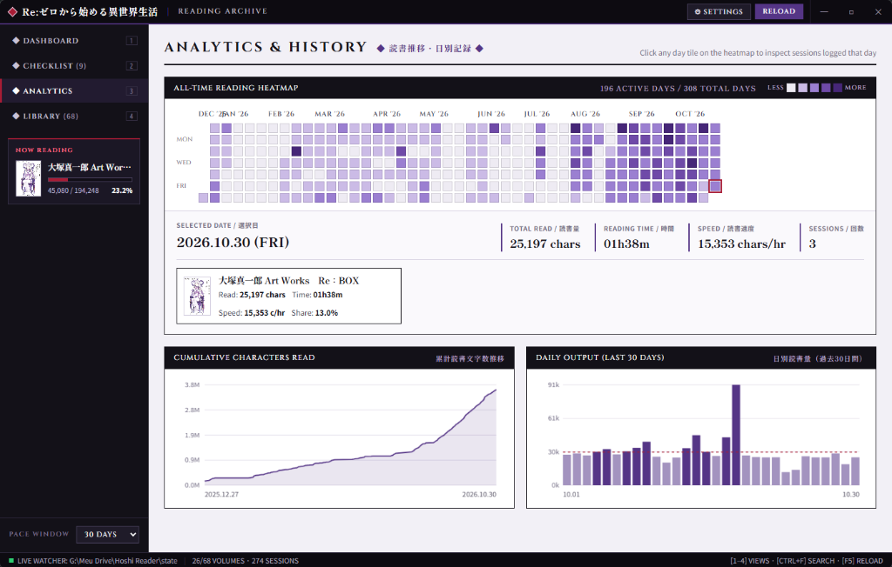
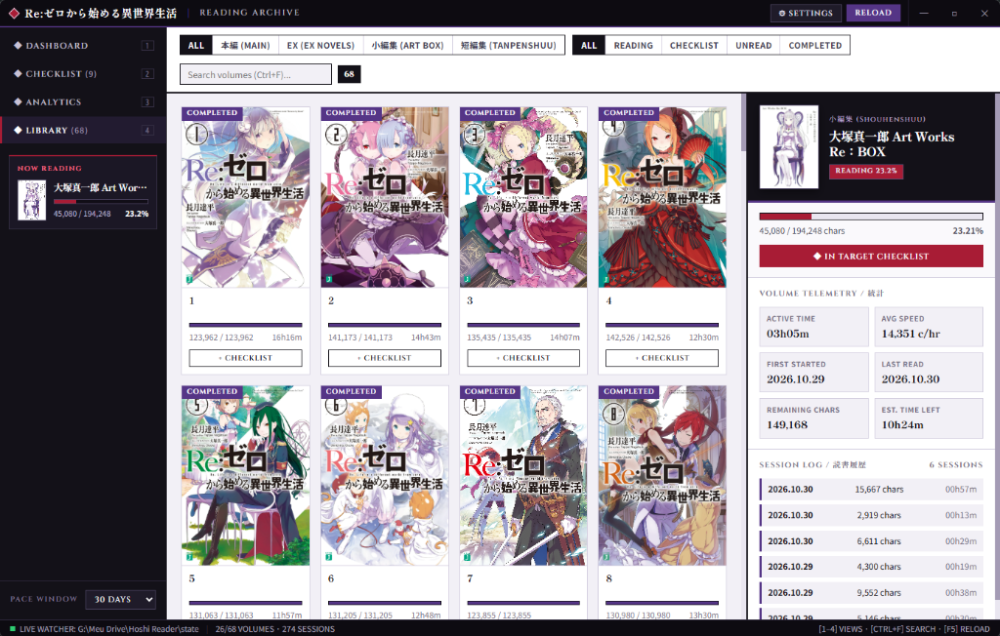

# Re:ゼロから始める異世界生活 — Reading Archive

A standalone native Windows desktop application built with **Tauri v2** (Rust + vanilla HTML/CSS/JS) that tracks reading progress, pace projections, target milestones, and session history directly from your local **Hoshi Reader** state files.



---

## Features

- **Native Frameless Desktop Shell**
  - Custom editorial titlebar (`Cinzel`, `Shippori Mincho`, `Noto Sans JP`), instant sidebar view switching, pinned **Now Reading** mini-card, and a live bottom status bar.
- **Live File Watcher (Zero-Click Sync)**
  - Watches your Hoshi Reader `state` directory in the background and automatically refreshes progress bars, heatmaps, and session logs as soon as Hoshi Reader saves or syncs a reading session.
- **Language- & Drive-Independent Auto-Discovery**
  - Automatically locates `<drive>\<Google Drive folder>\Hoshi Reader\state` across any mounted drive letter (`G:\`–`Z:\`, `C:\`–`F:\`) and any OS/Google Drive language (`My Drive`, `Meu Drive`, `Mi unidad`, `マイドライブ`, `Mon Drive`, `Meine Ablage`, etc.).
- **Configurable Hoshi Reader Shelves**
  - Defaults to the 4 *Re:Zero* shelves (`Re:ゼロ`, `Re:ゼロ 短編集`, `Re:ゼロ Ex`, `Re:ゼロ 小編集`), with an in-app **Settings (`⚙ SETTINGS`)** modal and `config.json` support to enable or customize any shelf in your Hoshi Reader `.shelves.json`.

---

## Workspace Views

### 1. Dashboard (`1`)
Displays overall completion percentage, total/read/remaining character counts, cumulative reading time, recorded pace projections (`7`, `14`, `30`, `90` days, or `All Time`), and a per-series breakdown table with estimated completion dates.


### 2. Target Checklist (`2`)
Plan custom reading milestones (e.g., *Road to Volume 21*) with net remaining characters, active hours required, days remaining, and target completion date based on your current pace.



### 3. Analytics & History (`3`)
Includes an all-time reading activity heatmap, an interactive **Selected Day Inspector** showing per-book session breakdowns for any date clicked, a cumulative characters read curve, and a 30-day daily output bar chart.



### 4. Library & Book Inspector (`4`)
Master–detail bookshelf with series/status filters and live search (`Ctrl+F`). Clicking any volume opens its telemetry in the docked right-hand **Book Inspector Drawer**, showing high-res cover art, active time, average reading speed (`chars/hr`), start/last-read dates, estimated time remaining, and a chronological log of every session recorded for that volume.



---

## Keyboard Shortcuts

| Shortcut | Action |
| :--- | :--- |
| `1` – `4` | Switch between **Dashboard**, **Checklist**, **Analytics**, and **Library** |
| `Ctrl + F` | Jump to **Library** and focus the volume search bar |
| `F5` / `Ctrl + R` | Reload Hoshi Reader state data |
| `Esc` | Close the Settings modal |

---

## Building & Running

### One-Click Build & Run (Windows)
Double-click **[`build.bat`](build.bat)** in the project root (or run `.\build.bat` in PowerShell). It compiles the release binary, copies `rezero-tracker.exe` and `WebView2Loader.dll` into the gitignored `release/` folder, and launches the app.

### Manual Build
```powershell
cd src-tauri
cargo build --release
New-Item -ItemType Directory -Force -Path "..\release" | Out-Null
Copy-Item "target\release\rezero-tracker.exe", "target\release\WebView2Loader.dll" -Destination "..\release\" -Force
```

---

## Configuration (`release/config.json`)

On first launch, `rezero-tracker.exe` automatically generates `config.json` next to the executable (and persists your milestone queue in `checklist.json`). You can configure settings either via the **`⚙ SETTINGS`** button in the titlebar or by editing `release/config.json`:

```json
{
  "hoshiReaderDir": null,
  "shelves": [
    {
      "shelf": "Re:ゼロ",
      "slug": "main",
      "name": "Main Novels",
      "categoryLabel": "本編 (Main Novels)",
      "filterLabel": "本編 (MAIN)"
    },
    {
      "shelf": "Re:ゼロ 短編集",
      "slug": "tanpenshuu",
      "name": "Tanpenshuu (短編集)",
      "categoryLabel": "短編集 (Tanpenshuu)",
      "filterLabel": "短編集 (TANPENSHUU)"
    },
    {
      "shelf": "Re:ゼロ Ex",
      "slug": "ex",
      "name": "EX Novels",
      "categoryLabel": "Ex (EX Novels)",
      "filterLabel": "EX (EX NOVELS)"
    },
    {
      "shelf": "Re:ゼロ 小編集",
      "slug": "shouhenshuu",
      "name": "Shouhenshuu (小編集)",
      "categoryLabel": "小編集 (Shouhenshuu)",
      "filterLabel": "小編集 (ART BOX)"
    }
  ]
}
```
